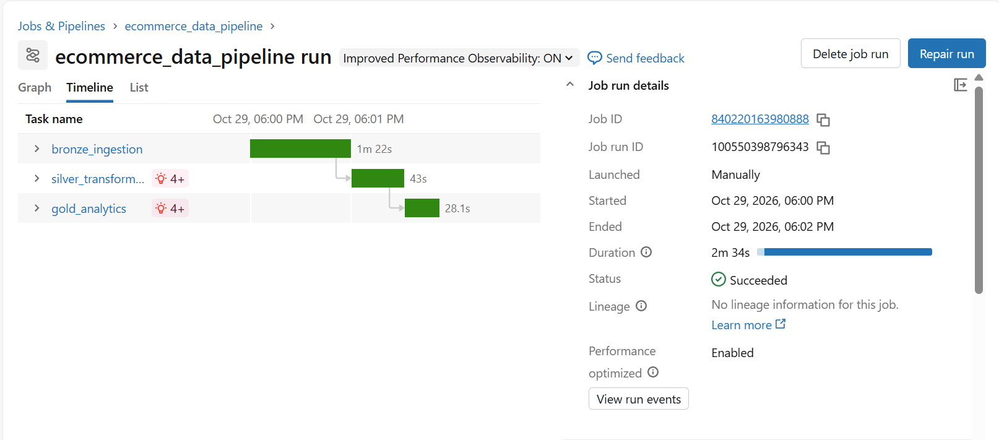

# E-commerce Data Pipeline with Databricks

An end-to-end data engineering project that processes the Brazilian Olist e-commerce dataset using **Databricks, PySpark, and Delta Lake**. The pipeline follows the **Medallion Architecture** and uses **Databricks Jobs** to orchestrate the workflow from raw CSV ingestion to analytical datasets.



## Project Overview

The goal of this project is to build a structured, repeatable data pipeline that transforms raw e-commerce data into analytics-ready tables. It demonstrates data ingestion, data cleaning, quality checks, distributed transformations, and workflow orchestration in Databricks.

## Architecture

The pipeline follows the Medallion Architecture:

```text
Olist CSV files
      |
      v
   Bronze  --> Raw data ingested into Delta tables
      |
      v
   Silver  --> Data cleaning, key filtering, and deduplication
      |
      v
    Gold   --> Business-oriented analytical tables
```

The three notebooks are orchestrated sequentially with Databricks Jobs:

1. `01_bronze_ingestion` — loads CSV files from a Databricks Volume into Delta tables.
2. `02_silver_transformation` — applies cleaning and deduplication rules and performs data quality checks.
3. `03_gold_analytics` — creates aggregated tables for monthly sales, product categories, and sellers.

## Tech Stack

- **Databricks** — managed platform for data engineering and Spark workloads.
- **PySpark** — distributed data processing and transformations.
- **Apache Spark** — execution engine for processing the dataset.
- **Delta Lake** — storage format for the Bronze, Silver, and Gold tables.
- **Databricks Jobs** — orchestration of notebook tasks with dependencies.

## Data Layers

### Bronze

The ingestion notebook reads the source CSV files from a Databricks Volume, preserves column headers, infers data types, and saves each source as a Delta table in the `workspace.default` schema.

### Silver

The transformation notebook creates cleaned Silver tables by filtering records with null keys and removing duplicates according to the configured keys. It also checks key integrity and relationships between core datasets.

Examples of Silver tables:

- `silver_orders`
- `silver_customers`
- `silver_order_items`
- `silver_order_payments`
- `silver_order_reviews`
- `silver_products`
- `silver_sellers`
- `silver_geolocation`
- `silver_category_translation`

### Gold

The analytics notebook creates three tables for downstream analysis:

| Table | Description |
|---|---|
| `gold_monthly_sales` | Monthly metrics for delivered orders, grouped by purchase month. Includes item sales, freight value, distinct orders, and item count. |
| `gold_sales_by_category` | Sales value, distinct orders, and item count grouped by product category. |
| `gold_sales_by_seller` | Sales value, freight value, distinct orders, and item count grouped by seller. |

**Metric scope:** `gold_monthly_sales` filters to delivered orders. The category and seller tables currently aggregate all records in `silver_order_items`, regardless of order status. Their totals therefore should not be interpreted as sales from delivered orders only.

## Data Quality Checks

The pipeline includes checks for:

- Null and duplicate keys in selected Silver tables.
- Orders without a matching customer.
- Items without a matching order.
- Null or negative item prices and freight values.
- Successful creation of the Gold tables.

Critical integrity checks raise an error if they fail, allowing the Databricks Job to stop before downstream tasks run.

## Repository Structure

```text
databricks-project/
├── notebooks/
│   ├── 01_bronze_ingestion.ipynb
│   ├── 02_silver_transformation.ipynb
│   └── 03_gold_analytics.ipynb
├── images/
│   └── databricks-job-success.png
└── README.md
```

## Running the Project

The notebooks were developed and executed in Databricks. To run the pipeline in another workspace:

1. Import the notebooks into Databricks.
2. Upload the Olist CSV source files to a Volume and update the Volume path if needed.
3. Ensure the target catalog and schema exist and that the execution identity has the required permissions.
4. Configure a Databricks Job with the three notebook tasks in order: Bronze → Silver → Gold.
5. Run the Job and review task output and logs.

The notebooks use Databricks-specific utilities and are intended to run in a Databricks environment. The source dataset is not included in this repository.

## Key Learnings and Future Improvements

This project provided hands-on practice with:

- Building a multi-layer ELT pipeline with the Medallion Architecture.
- Using PySpark for distributed data transformations.
- Persisting datasets as Delta tables.
- Implementing data quality checks.
- Orchestrating dependent notebook tasks with Databricks Jobs.

Potential next steps include incremental ingestion, more comprehensive data quality rules, pipeline monitoring, and performance optimization based on execution plans and workload measurements.

---

**Dataset:** [Brazilian E-Commerce Public Dataset by Olist on Kaggle](https://www.kaggle.com/datasets/olistbr/brazilian-ecommerce)
